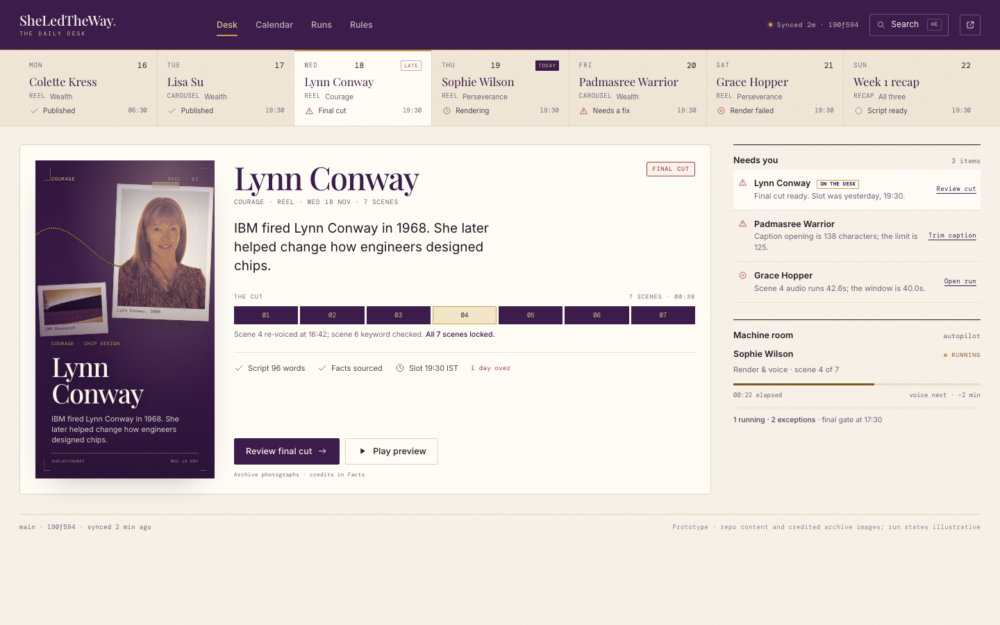
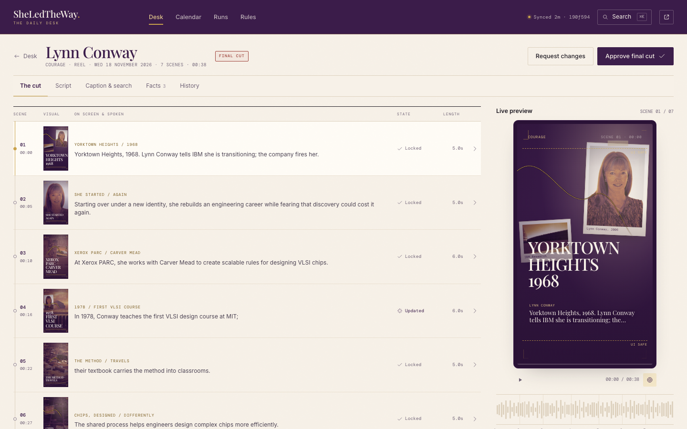
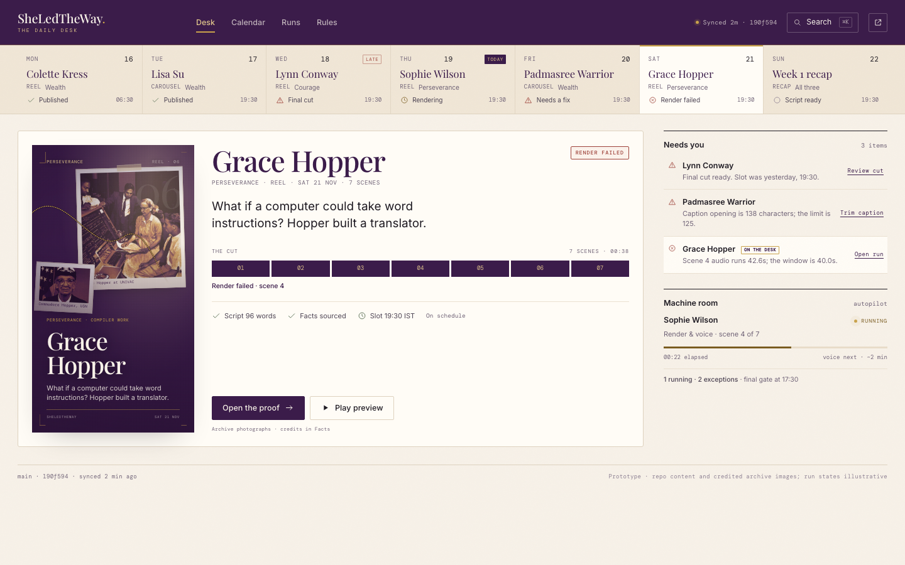
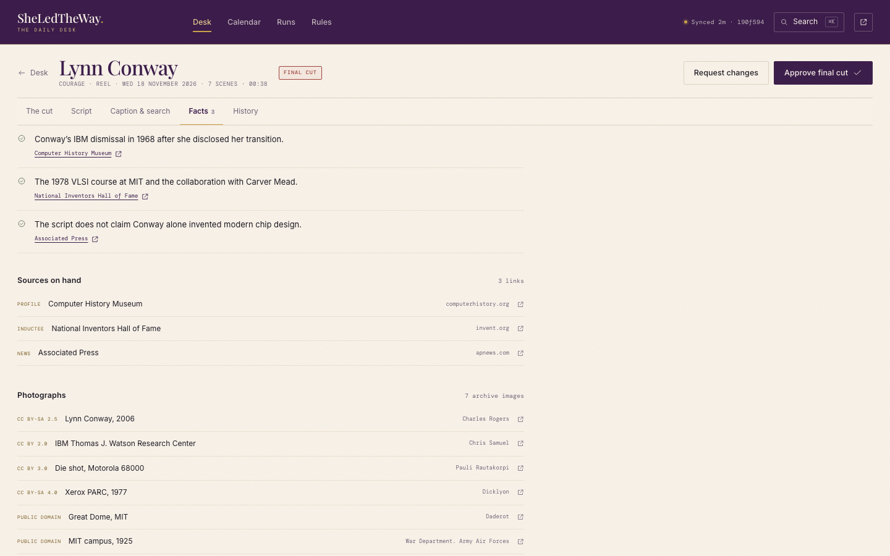
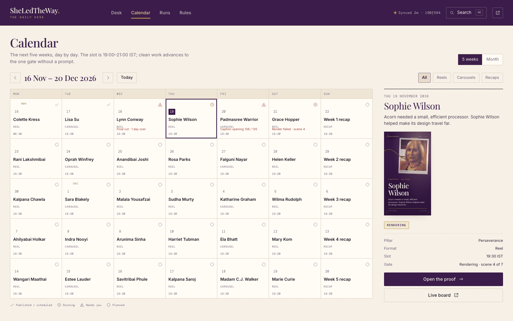
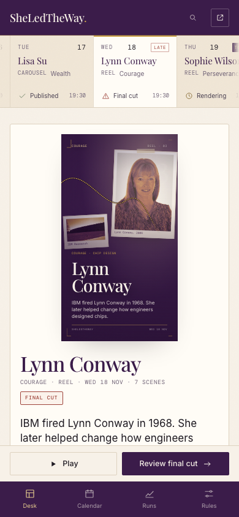

# SheLedTheWay — The Daily Desk

A redesign of the production interface for a one-person, automated daily Reel channel.
Open `design/index.html` to use the prototype.

---

> **A note on the repo during this pass.** While the redesign was in progress, `webapp/app.py` was changed separately to a cinema-rail board with flat typographic posters, and it arrived with a syntax error in the poster template. I fixed the syntax error and left the rest of that board untouched. This document and the prototype describe the scene-level Desk/Studio direction; the photo collage is implemented there. The cinema rail is still poster-only. If that rail is the direction you want to keep, the same image and credit layer can be ported into it.

## The problem in one line

The pipeline is already automated. The interface is a form queue. Human attention is the throughput ceiling because every story is presented as six equal stages, every section as a textarea, and every agent as a markdown file.

The live board at `myhermes.phoneme.in` proves it: a vertical stack of 14 identical cards, a story editor with seven stacked textareas, an Agents page with raw prompts, and no calendar UI even though the calendar is the actual plan. The work is not missing automation. The work is missing **a way to see what the automation did, what it needs, and what happens next**.



*The Desk: one story on the desk, the week above it, three exceptions in the rail.*



*The Studio: seven scenes in the proof margin, a live 9:16 frame, one gate in the header.*



*The archive layer: Grace Hopper at UNIVAC, a portrait printed on ivory paper, a stitched thread, and the same one-gate proof around it.*



*Facts carries the provenance: seven archive images, their creators, licenses and source links.*



*The Calendar: five weeks of the plan, not an empty month grid.*



*The same desk at 390px: the week scrolls, the proof stacks, the gate is still one decision.*

The attached concept document is right about the direction: exception-first, split-screen studio, automated gates. This design goes further in three places:

1. **The calendar is the home, not a toggle.** A daily show is a run of show. The week's strip and the five-week run are the spine; the Kanban is another abstraction between the owner and the plan.
2. **The Reel is scenes, not sections.** A cut is seven scenes with timecodes, visuals, spoken lines and durations. Editing sections blind is the root of the verbosity.
3. **The interface is an editor's proof desk, not a dashboard.** The world is paper, proof marks, timecodes and one approval stamp. It is calm because the work is a daily edition, not a monitoring wall.

---

## What changed

| Current | New | Why |
|---|---|---|
| `/` is a vertical card stack with six stage boxes per story | **Desk**: the week as a run-of-show strip, one story on the desk, one decision, exceptions only | Answers "what needs me now?" in one viewport |
| `/story/<date>/edit` is seven textareas | **Studio**: a scene ledger with a proof margin, live 9:16 preview, waveform, per-scene actions | Editing a cut, not a document |
| The media sits in a separate column, often "not rendered yet" | The preview is the right pane; safe zones, captions and scene timecodes are visible | No blind regeneration |
| `/agents` exposes seven `.md` files | **Rules**: human-readable gate cards, pass/fail counts, diffs, chat, raw source behind disclosure | Control without prompt literacy |
| `/activity` is three tables | **Runs**: live stage, gate ledger, run log, retry, next queue, autonomy switches | Automation you can see and steer |
| A calendar CSV, no calendar UI | **Calendar**: five-week run (default) and month, format filters, slot, status | The plan is a first-class surface |
| Approve script, then approve media | **One gate per Reel**: final cut; scripts, SEO, render and voice auto-advance | One confident decision, not six touches |
| A generic "regenerate the video" note | Per-scene **Regenerate visual** / **Re-voice line** | Fix one scene; keep the rest |
| Generic status colours and no consequence | A stamp, a consequence list, a late-slot recovery, undo until five minutes before the slot | The owner knows what the click will do |

---

## The model

**1. The week is the plan.** The Desk opens on the current week, with today marked and the late cut flagged. The Calendar shows the next five weeks — the actual planning horizon — with month as a secondary view.

**2. The cut is the object.** A story becomes a cut at the gate. The cut is seven scene rows, each with a timecode, a visual, an on-screen line, a spoken line and a duration. The preview is the same object at 9:16.

**3. The exception is the work.** The default is autonomy. The owner sees only what a gate could not settle: a missing source, a caption three characters over, a scene whose audio overruns, a render failure, a late slot. Every exception has a one-line reason and one action.

**4. The gate is one.** The owner approved one human gate: the final cut. Script, sources, SEO, render and voice must pass automatically. If a gate fails, the story stops before the final cut, not at it. The Rules screen keeps that gate fixed and labelled "Owner".

**5. The record is git.** Every action states what it commits and what it changes. The footer shows the branch, commit and sync age. There is no hidden database.

---

## The screens

### Desk

- **Week strip** — Mon–Sun, name, format, pillar, status mark, slot. Today is marked; a late story is marked. Selecting a day changes the story on the desk without leaving the page.
- **The proof** — a typographic cover, the hook, a seven-segment cut bar, the gate result, the slot, and the primary action.
- **Needs you** — the exception queue with a reason and a CTA. Three items in the demo: the late final cut, a caption over 125 characters, a failed render.
- **Machine room** — what Hermes is running, the scene it is on, elapsed and ETA, and what comes next.

### Studio

- **Scene ledger** — the proof margin carries the scene number and timecode. Each row pairs a storyboard thumb, the on-screen line and the spoken line. The selected row opens a two-field editor and three targeted actions.
- **Live preview** — a 9:16 frame with Instagram safe zones, a duotone archive collage, the scene art, the spoken caption, a playhead, a waveform with scene ticks, and the one-gate note.
- **Tabs** — The cut, Script, Caption & search, Facts, History. Each tab is a different question, not another wall of text. Facts now also carries the photograph credits.
- **Approval** — the dialog states the slot, destinations, files committed and the undo window. Approving produces a stamp on the cut and, for a late story, moves the slot to the next open time. On mobile, the Desk and the Studio both carry the gate in a fixed bar above the bottom nav.

### Calendar

- **Five-week run** default: 35 days, every day with a story, the month boundary tagged, today outlined, exceptions marked.
- **Month** secondary: the familiar grid.
- **Side panel** for the selected day: cover, hook, format, slot, gate, and the action.
- **Filters** by Reel, Carousel, Recap.

### Runs

- **Now** — a dark running card with the live stage, elapsed, ETA, gate and log tail.
- **Stage rail** — Research through Publish, each node with a time and a state; clicking opens the gate criteria.
- **Recent runs** — time, story, stage, result, detail, duration. Rows open the run log.
- **Autonomy** — three switches: auto-advance clean work, pause at the final cut, alert on a failed gate.

### Rules

- Stage nav with rule counts and proposal badges.
- Human-readable gate cards: title, one-line behaviour, pass/paused counts, active/paused, source disclosure.
- Proposed changes as a before/after diff with Approve, Reject, Ask why.
- Agent chat is a conversation about a rule, not a prompt editor.

---

## The archive layer

The interface now has a second material: real photographs. Each Lynn scene is a small collage, not a colour panel.

- **Scene 1, Yorktown Heights, 1968:** her 2006 portrait as a paper print, pinned beside the IBM Research Center. The institution and the person in one frame.
- **Scene 2, she started again:** the portrait fills the frame, sharp and close, so the private cost is the image rather than a caption.
- **Scene 3, Xerox PARC:** a die shot as the ground, the 1977 PARC building as a small print. The work and the place.
- **Scene 4, MIT, 1978:** the Great Dome behind a small portrait print. The institution receives her.
- **Scene 5, the method travels:** the 1925 campus aerial and a silicon wafer. The idea outliving the room.
- **Scene 6, chips designed differently:** a wafer as the ground, the die as the print. The work close up.
- **Scene 7, she led the way:** her face returns, with a warm light and the gold line.

The **thread** is the throughline: a single gold stitch that moves through the photographs and is masked out before the name. The **paper print** is the archive: ivory border, tape, a small mono caption, a 2° rotation. The **scrim** is the proof desk: the photograph can be atmospheric, but the story type stays legible.

Every image is a real, credited Commons/archive photograph, duotoned and cropped. There is no AI likeness. The full source, creator and license list is in `design/IMAGE-CREDITS.md`, and the same record appears in Studio → Facts → Photographs. If the site or Reels go public, the CC BY-SA images need the share-alike check described there, or a public-domain swap.

## How this fixes verbosity and control

- **Summary first.** A gate is one sentence, a count and a state. The raw SOP is one click away, never the default.
- **Structure, not textareas.** Scenes, fields and counts. The on-screen line and the spoken line are separate because they are separate in the video.
- **Evidence visible.** Facts show the claim, the source and the verification. Caption openings show a meter against 125. Voice shows loudness and the end-before-fade rule.
- **Consequence before action.** "Publishes today, 20:30 IST · 2 files · undo until 20:25" is on the approval dialog, not learned after the fact.
- **Per-scene control.** Regenerate one visual, re-voice one line, ask for alternatives on one section. The rest of the cut is untouched.
- **Late stories have a recovery.** A one-day-late cut is not a dead card. Approving moves it to the next open slot, and the dialog says so.
- **Autonomy is adjustable.** Stage gates can be paused one at a time, and the owner gate stays fixed. The owner can see what will pause before it does.

---

## The automation contract

| Stage | Auto-advance when | Pause when | Default |
|---|---|---|---|
| Research | At least two reputable sources; dates and milestones verified | Fewer than two sources, or conflicting dates | Auto |
| Fact-check & draft | Every claim cited; 80–100 words; ends "She led the way." | Unverified quote, word count out of range, sensitive claim | Auto |
| SEO | Caption opening ≤125; name and topic aligned in caption, speech and on-screen text | Keyword mismatch, missing name, hashtag overflow | Auto |
| Render | 7 scenes, 30–45s, 1080×1920, first-scene keyword present | Timeout, audio overflow, safe-zone collision | Auto |
| Voice | −14 LUFS ±2 dB; speech ends before the fade | Clip overflow, missing clone once configured | Auto |
| Review | — | Always: the owner's final cut | **Human** |
| Publish | Status is exactly `Approved` at the slot | API rejection, token expiry, interrupted publish | Auto + retry |

**Exception taxonomy.** Source gap (amber), fact conflict (amber), caption length (amber), duration or loudness (rose), render failure (rose), publish/API failure (rose). Each carries a reason and an owner action; none is a dead end.

---

## The one backend change: scenes

The prototype is built on a scene structure. The current pack uses one `## Voiceover` block and one `## Visual notes` block, so the UI would have to guess the cuts. The recommendation is additive: keep every existing heading, add a `## Scenes` block, and generate the current `## Voiceover` from it for compatibility.

```markdown
## Scenes

### 01 · 00:00–00:05
- On screen: YORKTOWN HEIGHTS / 1968
- Voiceover: Yorktown Heights, 1968. Lynn Conway tells IBM she is transitioning; the company fires her.
- Visual: Location card. Ivory type on plum. No portrait.

### 02 · 00:05–00:10
- On screen: SHE STARTED / AGAIN
- Voiceover: Starting over under a new identity, she rebuilds an engineering career...
- Visual: One line of type, held. Gold rule under the second line.
```

- **Parser.** `split_pack` still splits on `##`; add `split_scenes(text)` for `### NN` blocks and their three fields. The existing `## Voiceover` remains the joined read for the current video and voice agents.
- **Decisions.** Add a `scene` column to `review/reviews.csv`, blank for a story-level decision. A scene flag is `date,stage=video|voice,scene,decision,note,at_ist`.
- **Agents.** `2-factcheck-draft` writes scenes and the joined voiceover. `3-video` rebuilds only the scenes whose on-screen text or visual changed, then re-stitches. `4-voiceover` re-voices only the flagged scenes and re-mixes. `5-review` is unchanged.
- **Migration.** Backfill the 12 existing packs from their voiceover. Colette Kress already carries timecodes; the others can be split at sentence boundaries, then hand-checked once. Keep the joined voiceover until every pack is migrated.
- **Fallback.** If a pack has no scenes, the Studio shows the script and a "not storyboarded" state. It does not invent scene cards.

**Live runs.** Add an append-only `runs/runs.csv` (or one JSON per run) written by Hermes: `at_ist,date,stage,state,detail,duration_s,commit`. The Runs screen reads it; no database, no new service. If that is too much for phase 1, derive the recent runs from `review/reviews.csv` and `git log` and label the view as history.

---

## Rollout

**Late-slot write.** If the owner approves a late cut, the action sets `date` to the current date and `time_ist` to the next open slot (20:30 in the demo) in `publish/queue.csv`, records the move in `review/reviews.csv`, and leaves the story date in `calendar/calendar.csv` as the editorial date. That is the two-file commit named in the dialog.

**Phase 1 — Desk and Studio, UI only (1–2 days).** New routes and the week strip; the Studio reads the current sections, derives a scene timeline from the voiceover timecodes, adds the 9:16 preview and the counters; the one-gate approval writes the queue and review as it does today. No schema change; keep the script gate if the final gate is not ready.

**Phase 2 — Scene schema (about 1 week).** Add `## Scenes`, the parser, the `scene` column and the migration. Turn on per-scene regenerate and re-voice. Update the three agent SOPs.

**Phase 3 — Autopilot and the Rules screen (about 2 weeks).** Add the run log, the stage gates, the exception taxonomy, the autonomy switches and the late-slot recovery. The one final gate becomes the default.

This preserves the git-backed CSVs, the standard-library server, the publishing script and every fact rule. It adds no database and no new hosting.

---

## What is deliberately unchanged

- **Brand.** Deep plum, antique gold, ivory, terracotta; Playfair Display and Inter; typographic covers; "She led the way."
- **Facts.** Every claim sourced, no invented quotes or numbers, disputed firsts disclosed, no net-worth figures, no AI likeness. Archive photographs are real, credited and duotoned; `design/IMAGE-CREDITS.md` records the licenses.
- **The record.** GitHub is still the database. Every action is a normal commit.
- **The publish path.** The `instagram.py` script still only posts rows whose status is exactly `Approved`.
- **The one human gate.** The owner chose one final cut; the Rules screen keeps it fixed.

---

## Evidence and caveats

- **Real content:** the 36 calendar rows, the Lynn Conway pack, the hooks, the caption, the sources and the failed-review history come from the repo.
- **Illustrative states:** run times, commit hashes, the 20:30 recovery slot, the 138-character Padmasree caption and the scene state labels are design fiction. The prototype labels itself "Prototype · repo content, illustrative run states."
- **Photography:** 13 real archive/Commons images, duotoned and credited in `design/IMAGE-CREDITS.md`. The chip and wafer are labelled context, not the specific VLSI work. Most portraits are CC BY or CC BY-SA rather than public domain; the public-release licence check is in the credits file.
- **Verified:** the prototype is checked at 1440×900 and at a true 390×844 mobile viewport. The approval dialog, scene editor, palette, tab set, calendar views, run drawer, rules chat and mobile layout were driven in a browser.
- **Not implemented:** the backend, the agent changes and the publishing flow. This is a design and implementation contract, not a deployed release.

---

## Files

- `design/index.html` — the clickable prototype.
- `design/styles.css` — the visual system, implemented.
- `design/app.js` — the interaction layer.
- `design/data.js` — repo content plus illustrative run states.
- `design/screens/` — final captures.
- `design/IMAGE-CREDITS.md` — every photograph, creator, license and source.
- `design/images/source/` and `design/images/processed/` — originals and duotone treatments.
- `DESIGN.md` — the token-bearing design system.
- `PRODUCT.md` — product truth captured before the design.
